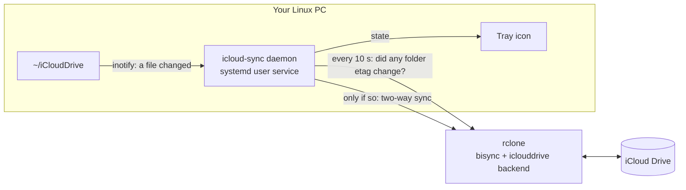

<p align="center">
  
</p>

<h1 align="center">icloud-sync</h1>

<p align="center">
  <b>iCloud Drive on Linux, as a normal folder that stays in sync by itself.</b><br>
  Two-way, automatic, with a tray icon and safety nets against data loss.
</p>

<p align="center">
  <a href="https://github.com/intilinux-eng/icloud-sync/actions/workflows/ci.yml"></a>
  <a href="https://github.com/intilinux-eng/icloud-sync/releases/latest"></a>
  <a href="LICENSE"></a>
</p>

<p align="center">
  
</p>

<p align="center"><a href="README.it.md">🇮🇹 Leggi in italiano</a></p>

---

Apple ships no iCloud client for Linux. `icloud-sync` gives you a folder, `~/iCloudDrive`, that behaves the way you expect: save a file on the PC and it shows up on your iPhone; add one from the phone and it lands on the PC, usually within half a minute.

It does not reimplement Apple's private API. It drives [rclone](https://rclone.org/iclouddrive/), which maintains the hard part (Apple sign-in, two-factor, Advanced Data Protection), and adds everything a daily-use sync client needs on top.

## Quick start

On Debian, Ubuntu and derivatives, download the `.deb` from the [latest release](https://github.com/intilinux-eng/icloud-sync/releases/latest), then:

```bash
sudo apt install ./icloud-sync_*_all.deb
icloud-sync setup
```

On any other distribution the whole program is one file with no Python dependencies:

```bash
python3 icloud-sync setup
```

`setup` walks you through everything: it installs rclone if yours is missing or too old, signs in to your Apple ID (you type the password and the two-factor code yourself; the password is kept only in rclone's local configuration), runs the first sync, and turns on the background service and the tray icon.

> With **Advanced Data Protection** enabled, first switch on *Access iCloud Data on the Web* on your iPhone (Settings → your name → iCloud).

## What you get

**Sync that keeps up**

- Local changes are picked up instantly through inotify and uploaded after a 5-second quiet period.
- iCloud is checked every 10 seconds with a single lightweight request; a full sync runs only when something actually changed.
- New files from your phone take a fast lane: only the folders that changed are visited, and the file is downloaded right away.

**Safety nets**

- A check file on both sides: if iCloud ever answers with a wrong or partial listing, nothing is touched.
- Mass deletions are stopped and reported instead of propagated; a side that looks empty is never mirrored.
- When the same file changes on two devices, the newer one wins and the other is kept as `name.conflict1.ext`.
- After a crash or power loss the sync state is rebuilt automatically, and rebuilding never deletes anything.

**A desktop citizen**

- Tray icon with the state at a glance, *Open folder* and *Sync now*.
- Notifications when a file arrives, when a conflict was kept, or when you need to act.
- A reminder four days before the Apple sign-in expires (Apple requires a new one about every 30 days).
- systemd user service, man page, menu entry, Debian package.

## How fast is it

Measured on a real iCloud Drive with about 1,200 files and 5 GB (November 2026, rclone 1.76):

| What happens | Time until the other side has it |
|---|---|
| You save a file on the PC | about 30 seconds |
| You add a file from iPhone or Mac | 20–30 seconds |
| You edit or delete a file on iCloud | 40–70 seconds |
| You rename a file on iCloud | up to 5 minutes |
| Nothing changed | one 0.5-second request every 10 seconds |

There is no push channel from iCloud that third-party clients can use, so this is not instant. Most of the remaining delay is on Apple's side: right after any change, iCloud answers listings about five times slower for a while.

## How it works



- **Engine.** `rclone bisync` does the two-way reconciliation, with `--resilient --recover --check-access --max-delete`.
- **Local side.** A recursive inotify watcher groups bursts of changes and starts a sync.
- **iCloud side.** iCloud gives every folder an etag that changes whenever anything inside it changes, at any depth. Reading the root is one request and tells whether the whole Drive is unchanged. This is what makes a 10-second check affordable.
- **Fast lane.** When the root changes, the daemon follows the changed etags down, one request per level, and downloads files that are new. It never overwrites or deletes; edits and deletions are left to the full sync that follows.
- **Failures.** Temporary errors are retried with growing delays. Errors that need you (sign-in expired, mass deletion) raise a notification that names the command to run.

## Limitations

- rclone's iCloud backend is marked **experimental** and uses Apple's unofficial web API. If Apple changes it, sync pauses until rclone catches up (`icloud-sync install-rclone` updates the binary). Your local files stay as they are in the meantime.
- **Shared folders and iWork documents** (Keynote, Pages, Numbers) cannot be downloaded through rclone today. They are excluded automatically, stay on iCloud only, and are listed by `icloud-sync skipped`.
- iCloud provides no checksums: files are compared by size and modification time.
- It is not an on-demand filesystem: every synced file takes disk space.
- A file named `RCLONE_TEST` appears in the Drive root. It is the check file; leave it there.
- The program's messages are currently in **Italian**; English is on the [roadmap](ROADMAP.md).

## Commands

```text
icloud-sync setup            guided configuration
icloud-sync status           state, last sync, days left on the Apple sign-in
icloud-sync sync             sync now (--dry-run to preview)
icloud-sync login            renew the Apple sign-in
icloud-sync skipped          items iCloud will not let rclone download
icloud-sync log              recent activity
icloud-sync doctor           full diagnostic
icloud-sync enable|disable   background service and tray icon
```

Settings live in `~/.config/icloud-sync/config.toml`, with a comment on every option.

## Alternatives

icloud-sync is not the only way to reach iCloud Drive from Linux, and another project may suit you better. As described in their own READMEs in November 2026:

| Project | Approach | Talks to iCloud through | Interface |
|---|---|---|---|
| [icloud-linux](https://github.com/IsmaeelAkram/icloud-linux) | FUSE mount with a local cache | pyicloud | command line |
| [icloud-drive-for-linux](https://github.com/taylorhayis/icloud-drive-for-linux) | selective folder sync | its own Rust client | GTK window and panel icon, Flatpak |
| [icloud-synk](https://github.com/kolesnikav/icloud-synk) | two-way sync, plus Photos download | its own Go client | command line |
| [OmaiCloud](https://github.com/matheusrrocha/omaicloud) | two-way sync on a timer | rclone bisync | Omarchy bar widget |

Choose icloud-sync if you want a full local copy that syncs both ways, a `.deb` you can install, a tray icon on a standard desktop, and an engine (rclone) that a large community keeps working when Apple changes things. Choose a FUSE mount if you would rather not keep every file on disk.

## Contributing

```bash
make test    # unit and integration tests (needs rclone: ./icloud-sync install-rclone)
make lint    # static checks (needs pyflakes)
make deb     # builds dist/icloud-sync_<version>_all.deb
```

The integration tests run the real program against a real rclone between two local folders. [CI](.github/workflows/ci.yml) runs them on Python 3.11 to 3.14, builds the package, checks it with lintian and installs it. Pushing a `vX.Y.Z` tag publishes a [release](.github/workflows/release.yml) with the `.deb` attached.

What is planned next: [ROADMAP.md](ROADMAP.md). What changed: [CHANGELOG.md](CHANGELOG.md).

## License

[MIT](LICENSE). Provided without any warranty: keep a backup of anything you cannot afford to lose.

Independent project, not affiliated with Apple Inc. iCloud is a trademark of Apple Inc.
